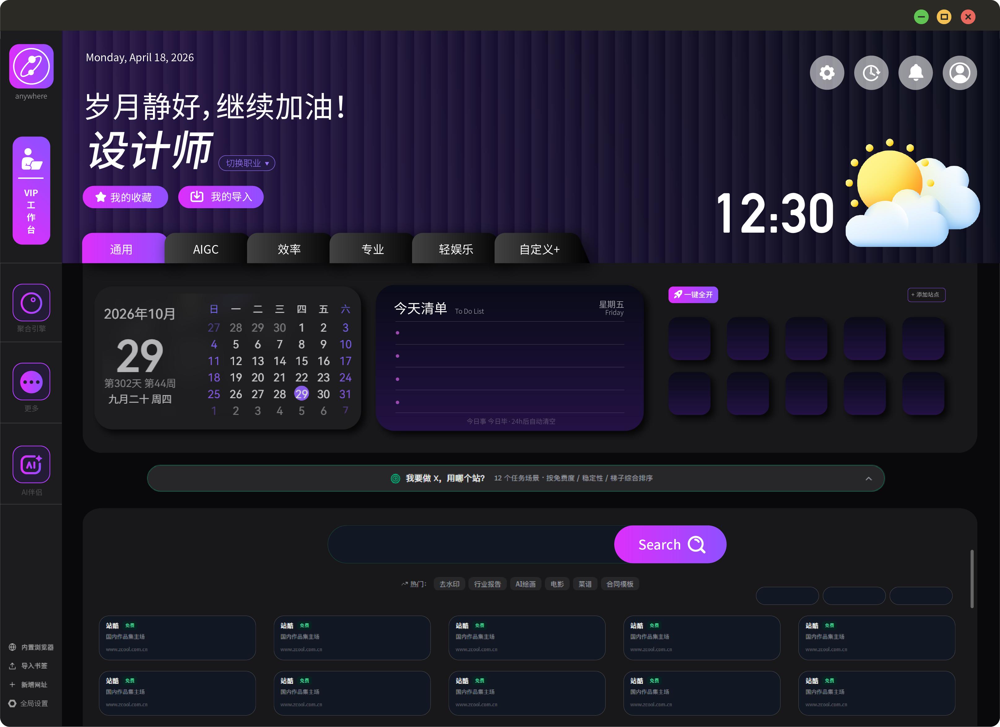
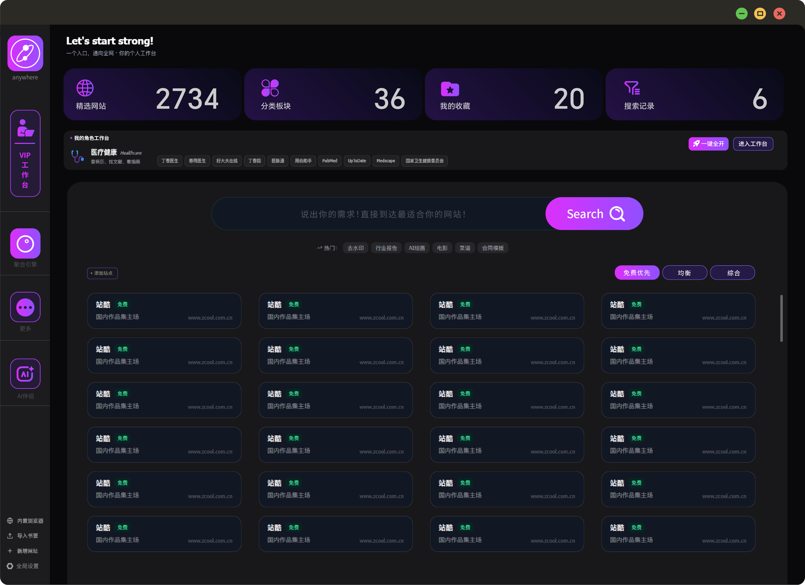
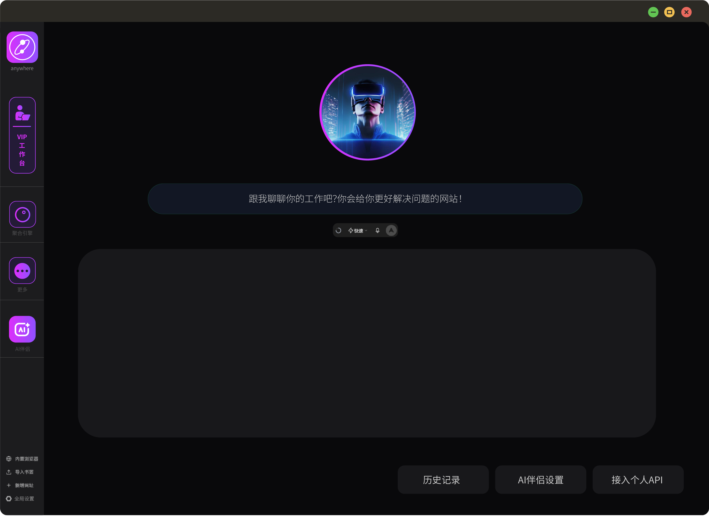

# ANYWHERE

> 一个入口，通向全网。

面向设计师与知识工作者的桌面工作台：把常用站点、聚合搜索、AI 助手和内嵌浏览器收进同一个窗口，减少在浏览器标签页之间来回切换的成本。

Windows 桌面应用，Electron + React 构建，MIT 开源。



## 功能

**工作台**

- 按职业组织的站点矩阵，首次启动选择职业后自动生成
- 聚合搜索引擎：一次输入，跳转到你选定的多个站点
- 自建收藏、自定义站点、自定义标签页
- 待办、天气、最近访问、灵感便签



**内嵌浏览器**

- 独立浏览器分区（`persist:anywhere`），与系统 Chrome 完全隔离，不读取你的 Chrome 账号和 Cookie
- 多标签、书签栏、历史记录、下载管理
- 广告与跟踪请求拦截
- 密码保险箱（本地加密存储，Windows DPAPI）
- 可注册为 http/https 协议候选，在飞书、微信里点链接直接跳进工作台内嵌浏览器打开

**AI 助手**

- 支持接入任意 OpenAI 兼容接口（自定义 Base URL / API Key / 模型）
- 内置每日免费额度，额度用尽可切换到自己的 API
- 对话流畅输出，结果可保存



**其他**

- 素材库：图片拖拽收集、标签管理、批量导出
- 跨站内容流：RSS 聚合，支持源健康检查
- 多账号：本机记住登录过的账号，一键切换
- 云同步：收藏、工作空间、书签、历史多设备同步
- 完整数据导出/导入、诊断日志导出

## 下载

前往 [Releases](https://github.com/chuyanyang666/anywhere/releases/latest) 下载最新安装包：

- `anywhere-setup.exe` — Windows 10/11 64 位

> 安装包暂未做代码签名，首次运行 Windows 可能提示「未知发布者」。
> 点击「更多信息」→「仍要运行」即可正常安装。

## 开发

```bash
# 安装依赖
npm install

# 浏览器模式调试前端
npm run dev

# 桌面端开发（Vite + Electron 热更新）
npm run dev:desktop

# 构建安装包
npm run dist
```

环境要求：Node.js 20+，Windows 10/11 64 位。

### 目录结构

```
electron/      主进程、内嵌浏览器窗口、preload
src/           React 前端（工作台、内容流、设置等）
public/        静态资源与图标
build/         打包用图标
tools/cf-worker  Cloudflare Worker 后端（账号与同步）
docs/          README 截图
```

## 隐私

所有收藏、书签、历史、密码默认只存在本机。只有登录账号后，收藏与工作空间才会同步到云端。

详见 [PRIVACY.md](PRIVACY.md)。

## 许可

[MIT](LICENSE)

使用前请阅读 [服务条款](TERMS.md)。
